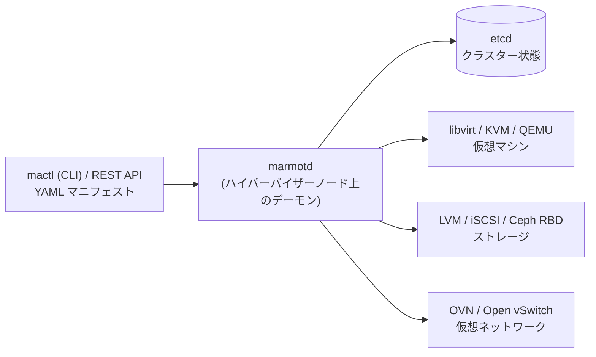

[](https://github.com/takara9/marmot/releases)
[](https://www.gnu.org/licenses/gpl-3.0)
[](https://github.com/takara9/marmot/actions/workflows/main.yml)
[](https://pkg.go.dev/github.com/takara9/marmot)
[](https://github.com/takara9/marmot/stargazers)

# Marmot — 1台のサーバーから始められる、Kubernetes対応のシンプルなプライベートクラウド

**YAML を書いて `mactl create -f` するだけで** 「仮想サーバー」、「仮想ネットワーク」、「ストレージ」、そして 「Kubernetes クラスタ」、「NLB/ALB」までが、数分で手元の Linux サーバー 1台上で手に入ります。

*English: Marmot is a simple, declarative private cloud built on KVM. Define VMs, networks, volumes and even Kubernetes clusters in YAML, and run them from a single Ubuntu server.*

[](https://www.youtube.com/watch?v=_Tw939fc54M)

---

## 30秒でわかる Marmot

Kubernetes のマニフェストを書く感覚で、仮想マシンを作ります。

```yaml
# server-20.yaml
apiVersion: v1
kind: Server
metadata:
    name: server-20
spec:
    cpu: 1
    memory: 1024
    mmImage: ubuntu24.04
    auth:
        publicKey: "ssh-ed25519 AAAA... For marmot VMs"   # 自分の公開鍵
        users:
         - ubuntu
    networkInterface:
        - networkname: host-bridge
```

```console
$ mactl create -f server-20.yaml
$ mactl get server
NAME        NODE      STATUS    CPU  RAM(MB)  IP-ADDRESS     NETWORK       AGE
----        ----      ------    ---  -------  ----------     -------       ---
server-20   marmot3   RUNNING   1    1024     192.168.1.20   host-bridge   5s

$ mactl ssh -i vmkey ubuntu@server-20       # DNS 設定なしで、サーバー名のまま SSH
ubuntu@server-20:~$
```

さらに、Kubernetes クラスタも YAML 1枚です。

```console
$ mactl create -f mke0.yaml                    # 3ノードの Kubernetes クラスタを自動構築
$ mactl get mke mke0 --download                # kubeconfig を取得
$ kubectl get node
NAME              STATUS   ROLES    AGE     VERSION
mke-mke0-node-1   Ready    <none>   2m43s   v1.36.4
mke-mke0-node-2   Ready    <none>   113s    v1.36.4
mke-mke0-node-3   Ready    <none>   65s     v1.36.4
```

> `kubectl` の `create` / `get` / `delete` に慣れた方なら、`mactl` はほぼ説明不要です。

---

## こんな方におすすめ

| あなたの状況 | Marmot でできること |
|---|---|
| 自宅ラボ・検証用に、複数の VM を手軽に立ち上げ直したい | YAML で定義し、作成・削除を何度でも再現できる |
| Kubernetes を学習・検証したいが、環境構築に時間を取られたくない | **MKE** で、YAML 1枚から Kubernetes クラスタを構築 |
| パブリッククラウドのコストや VMware ライセンスを見直したい | 手元のサーバーで動く OSS（GPL-3.0）のプライベートクラウド |
| OpenStack は重い、GUI 中心の運用は避けたい | 少数のコンポーネントと CLI / REST API による IaC 運用 |
| 小規模チームで、Ansible と組み合わせた構成管理をしたい | `mactl` が Ansible と連携して起動後の VM をセットアップ |

## なぜ Marmot？

インフラ運用は複雑になり続けています。Marmot は、その課題に対する次の答えです。

| 課題 | Marmot のアプローチ |
|---|---|
| パブリッククラウドのコスト増大 | 手元の **Linux 1台** から始められる |
| 高額な VMware ライセンス | **OSS (GPL-3.0)**。KVM / libvirt / OVN など実績ある OSS の組み合わせ |
| GUI 依存の運用 | **YAML による IaC**。変更履歴を Git で管理できる |
| OpenStack の重厚なアーキテクチャ | 本当に必要な機能に集中し、**学習コストを最小化** |

Kubernetes のコンテナ基盤は画期的ですが、導入や運用は複雑になりがちです。Marmot は **宣言型運用の良さだけを取り入れ**、「プライベートクラウドをもっとシンプルに」を目指しています。

---

## 主な機能

| 分野 | 機能 |
|---|---|
| **宣言的な運用** | YAML 宣言（サーバー・ネットワーク・ボリュームを1ファイルで定義） / リソースコントローラーによる自動実行（「あるべき姿」を書くだけ） / OpenAPI v3 REST API で完全制御 |
| **仮想マシン** | Cloud Image で OS インストール不要・即時作成 / マルチホーム（1 VM に複数ネットワーク） / ノードセレクターによるクラスタ内の配置制御 |
| **ストレージ** | ローカル（LVM / QCOW2） / iSCSI ネットワークブロック（LVM を iSCSI ターゲット化） / Ceph RBD（`hdd` / `ssd` / `nvme` クラス別プール） |
| **ネットワーク** | ホストブリッジ / OVN・OVS・Geneve オーバーレイ / 内部 DNS（VM 名の自動解決） / OpenVPN ゲートウェイ（PC ⇔ VM 用プライベートネットワーク）/ NATゲートウェイ |
| **ロードバランサー** | Application LB（HAProxy ベース L7、VM として自動デプロイ） / Network LB（iptables ベース L4） |
| **Kubernetes** | **MKE (Marmot Kubernetes Engine)**：ノード数・CPU/メモリ・CNI（Cilium 選択可）・外部接続ネットワークを宣言するだけで、コントロールプレーン、ワーカー、専用 LB、Ceph ストレージ連携まで自動構築 |
| **運用・セキュリティ** | etcd によるクラスター状態管理 / RBAC（Administrator・Compute-Operator・Viewer など） / OpenTelemetry メトリクス（Prometheus エクスポーター）と Loki へのログ転送 |

**対応OS**

| 区分 | 対応 |
|---|---|
| ホスト OS | Ubuntu 24.04 |
| ゲスト OS | Ubuntu 22.04 / 24.04 / 26.04、Alpine 3.23、Rocky Linux 8 / 9 / 10、AlmaLinux 8 / 9 / 10、Debian 11 / 12 / 13, Windows Server 2022 / 2025  |

## アーキテクチャ



| コンポーネント | 説明 |
|---|---|
| `marmotd` | ハイパーバイザーノード上で動作するデーモン。libvirt / LVM / OVN(OVS) を操作して VM を管理する |
| `mactl` | CLI クライアント。YAML ファイルまたは URL を指定して、サーバー・ネットワーク・ボリュームなどを操作する |
| `maadm` | 管理者向け補助ツール（改修中のため使用は非推奨） |

---

## クイックスタート

Ubuntu 24.04 のサーバーが1台あれば、約4ステップで VM と Kubernetes クラスタまで体験できます。


## 0. 動作環境を確認する

- Ubuntu Linux 24.04 がインストールされていること
- ルート `/` に 3GB 程度の空きがあること（依存モジュール約 1.2GB をインストールします）
- `/var/lib/marmot` に 30GB 程度の空きがあること（OS イメージ取得に約 2GB、VM 1台の起動に 16GB を消費します）
- CPU の仮想化支援機能（Intel VT-x / AMD-V）が有効であること

## 1. インストールする


[](https://www.youtube.com/watch?v=GoVrP9sq2tI)

文字が潰れて見えない時は、歯車マークをクリックして、画質を高くしてご覧ください。


[Releases](https://github.com/takara9/marmot/releases) の最新版 `.deb` をインストールします。

```bash
cd /tmp
apt-get update
VERSION=0.37.0    # 最新バージョンは Releases で確認してください
curl -OL https://github.com/takara9/marmot/releases/download/v${VERSION}/marmot_v${VERSION}_amd64.deb
sudo apt install -y ./marmot_v${VERSION}_amd64.deb
```

サーバーと通信できているか確認します。Server と Client の両方のバージョンが表示されれば成功です。

```console
$ mactl version
Server version = 0.37.0
Client version = 0.37.0
```

設定は `/etc/marmot/marmotd.json-sample` と `/etc/marmot/mke.json-sample` を参考に行ってください。
詳しい手順： [シングル構成](docs/HOWTO-install-marmot.md) / [クラスタ構成](docs/HOWTO-install-marmot-cluster.md)

## 2. ログインする

初期管理者アカウントは `admin`、初期パスワードは `passw0rd` です。**初回ログイン時にパスワード変更が必要です。**

```console
$ mactl login admin
Password: ＜パスワードを入力＞
Successfully logged in as admin
⚠️  You must change your password before using other commands.
   Run: mactl passwd

$ mactl passwd
Current Password: ＜現在のパスワードを入力＞
New Password:     ＜新しいパスワードを入力（英数字 8 文字以上）＞

$ mactl whoami
User:  admin
Roles: [Administrator]
```

セッションを終了するときは `mactl logout` を実行します。

## 3. 仮想サーバーを作る

SSH 鍵ペアを作成し、公開鍵を埋め込んだマニフェストを生成します。そのままコピー＆ペーストで動きます。

```bash
ssh-keygen -t ed25519 -f ./vmkey -C "For marmot VMs" -N ""

cat > server-20.yaml <<EOF
apiVersion: v1
kind: Server
metadata:
    name: server-20
    comment: marmotホストが繋がるネットワークに接続する仮想サーバー
spec:
    cpu: 1
    memory: 1024
    mmImage: ubuntu24.04
    auth:
        publicKey: "$(cat ./vmkey.pub)"
        users:
         - ubuntu
    networkInterface:
        - networkname: host-bridge  # marmot のサーバーが接続されるネットワーク
EOF
```

> `networkname: host-bridge` を使う場合、デフォルト値を `/etc/marmot/marmotd.json` に設定しておく必要があります。

作成・確認・ログイン・削除は、次のとおりです。初回は OS イメージの取得のため、少し時間がかかることがあります。

```console
$ mactl create -f server-20.yaml                  # 作成

$ mactl get server                                # 確認
NAME        NODE      STATUS    CPU  RAM(MB)  IP-ADDRESS     NETWORK       AGE
----        ----      ------    ---  -------  ----------     -------       ---
server-20   marmot3   RUNNING   1    1024     192.168.1.20   host-bridge   5s

$ mactl ssh ubuntu@server-20 -- -i vmkey          # ログイン
ubuntu@server-20:~$ exit

$ mactl delete server server-20                   # 削除（server-20,server-21 のようにカンマ区切りで複数指定も可能）
```

**`mactl ssh` について**：DNS を設定せずに、サーバー名で SSH ログインできます。

```
mactl [mactlのフラグ] ssh [USER@]SERVER-NAME -- [SSH-ARGS...]
```

内部 DNS は `サーバー名.ネットワーク名` に加え、`marmotd` ごとのサブドメイン付き FQDN にも対応しています。

- 例1: `server1.host-bridge`
- 例2: `server1.host-bridge.marmot1.labo.local`

## 4. Kubernetes クラスタを作る（MKE）

[](https://www.youtube.com/watch?v=Ozy6E7W0pHA)

MKE (Marmot Kubernetes Engine) なら、Kubernetes の詳しい知識がなくても、YAML 1枚でクラスタが手に入ります。

```bash
cat > mke0.yaml <<EOF
apiVersion: v1
kind: KubernetesEngine
metadata:
    name: mke0
    comment: 検証用K8sクラスタ
spec:
    version: "1.36"
    nodes: 3
    nodeSpec:
        cpu: 2
        memory: 4192
        auth:
            publicKey: "$(cat ./vmkey.pub)"
EOF
```

```console
$ mactl create -f mke0.yaml                       # クラスタの作成

$ mactl get mke                                   # 状態の確認
NAME   VERSION   NODES   STATUS    AGE
----   -------   -----   ------    ---
mke0   1.36      3       RUNNING   3m

$ mactl get mke mke0 --download                   # kubeconfig のダウンロード
kubeconfig downloaded: /home/ubuntu/.kube/config

$ kubectl get node                                # kubectl で操作
NAME              STATUS   ROLES    AGE     VERSION
mke-mke0-node-1   Ready    <none>   2m43s   v1.36.4
mke-mke0-node-2   Ready    <none>   113s    v1.36.4
mke-mke0-node-3   Ready    <none>   65s     v1.36.4

$ mactl delete mke mke0                           # クラスタの削除
```

Ceph CSI によるストレージ連携やロードバランサー連携など、詳細な設計は [docs/MEMO-marmot-kubernetes-engine.md](docs/MEMO-marmot-kubernetes-engine.md) を参照してください。

## （オプション）Ceph ボリュームを使う

`type: ceph` の Volume を VM にアタッチできます。`storageClass`（`hdd` / `ssd` / `nvme`）に応じて、`marmotd` が Ceph プールを選択します。

**事前準備**

- [Ceph の仮想サーバー](https://github.com/takara9/marmot-manifests/tree/main/56-ceph-single-node)を Marmot 上に起動しておく（Ceph サーバーの準備）
- `marmotd` を実行するホストに `ceph-common` をインストールし、`ceph` / `rbd` コマンドが使えること
- `/etc/ceph/ceph.conf` と `/etc/ceph/ceph.client.admin.keyring` が配置済みで、`marmotd` の実行ユーザーから読み取れること
- Ceph 側で利用する pool を事前に作成しておくこと

**`/etc/marmot/marmotd.json` の設定例**

```json
{
    "ceph_enabled": true,
    "ceph_pool_by_class": [
        { "storageClass": "hdd",  "pool": "marmot-hdd" },
        { "storageClass": "ssd",  "pool": "marmot-ssd" },
        { "storageClass": "nvme", "pool": "marmot-nvme" }
    ]
}
```

`ceph_pool_by_class` は配列形式で指定します。`storageClass` と pool の対応が未設定の場合、Ceph Volume の作成は失敗します。

**Volume の作成**

```yaml
# volume-ceph.yaml
apiVersion: v1
kind: Volume
metadata:
    name: data-ceph-01
spec:
    kind: data
    type: ceph
    size: 20
    storageClass: ssd
```

```console
$ mactl create -f volume-ceph.yaml     # 作成
$ mactl get volume                     # 確認
$ mactl delete volume data-ceph-01     # 削除
```

---

## 次のステップ

| やりたいこと | リンク |
|---|---|
| まず手を動かして学びたい（30分コース / 2時間コース） | [Marmot Tutorial](https://github.com/takara9/marmot-manifests/blob/main/TUTORIAL.md) |
| 実用的なマニフェストを眺めて真似したい | [Marmot マニフェスト集](https://github.com/takara9/marmot-manifests) |
| コマンド・サブコマンド・オプションを調べたい | [Command Reference](https://github.com/takara9/marmot-manifests/blob/main/COMMAND_REFERENCE.md) |
| クラスタ構成で運用したい | [marmotd クラスタ構成](docs/HOWTO-install-marmot-cluster.md) |
| Kubernetes（MKE）の設計を知りたい | [MKE 設計メモ](docs/MEMO-marmot-kubernetes-engine.md) |
| 質問・相談・アイデアを共有したい | [GitHub Discussions](https://github.com/takara9/marmot/discussions) |

## プロジェクトの状況

- バージョンは **v0.x（開発中）** です。機能追加と改善を継続しています。
- ホスト OS は現在 **Ubuntu 24.04** に対応しています。
- `maadm` は改修中のため、使用は推奨しません。

不具合の報告や機能要望は [Issues](https://github.com/takara9/marmot/issues) へお寄せください。

## 主な利用技術

Marmot は、実績ある OSS の組み合わせで構成されています。

| 技術 | 用途 |
|---|---|
| [KVM / QEMU](https://www.linux-kvm.org/) | 仮想化 |
| [libvirt](https://libvirt.org/) | VM ライフサイクル管理 |
| [OVN](https://www.ovn.org/) / [Open vSwitch](https://www.openvswitch.org/) | 仮想ネットワークの制御プレーン / データプレーン |
| [Geneve](https://www.redhat.com/ja/blog/what-geneve) | クラスタ構成時のオーバーレイ・ネットワーク |
| [etcd](https://etcd.io/) | 分散 KV ストア（クラスター状態管理） |
| [LVM](https://sourceware.org/lvm2/) | 論理ボリューム管理 |
| [open-iscsi / targetcli](https://github.com/open-iscsi/open-iscsi) | iSCSI ネットワークブロックストレージ |
| [Ceph](https://ceph.io/) | RBD による分散ブロックストレージ |
| [OpenTelemetry](https://opentelemetry.io/ja/) | メトリクス公開・ログ送信による可観測性 |
| [OpenVPN](https://openvpn.net/) | プライベートネットワークへのセキュアな接続 |
| [Ansible](https://docs.ansible.com/) | `mactl` と連携した、起動後の仮想サーバーのセットアップ |
| [Go](https://go.dev/) | Marmot の実装言語 |

## 貢献

貢献を歓迎します。ガイドラインは [CONTRIBUTING.md](CONTRIBUTING.md) を参照してください。
Star ⭐ やフィードバックも、開発の大きな励みになります。

## ライセンス

GNU General Public License v3.0 — 詳細は [LICENSE](LICENSE) を参照してください。

## 開発者について

Marmot は、30年以上にわたりエンタープライズシステム、仮想化基盤、クラウド技術に携わってきたインフラエンジニアが開発しています。大規模システムの構築・運用を経験した後、クラウド基盤を利用した開発とテクニカルセールスに従事する中で、Kubernetes とコンテナが画期的である反面、導入や運用が複雑化し、多くの利用者にとって扱いにくくなっていると感じてきました。Marmot は、その課題に対する一つの答えとして生まれました。

> **「プライベートクラウドをもっとシンプルに。」**

メンテナー： [takara9](https://github.com/takara9)