# Windows Server 2022/2025 の作成手順

Linuxの起動イメージは、各Linuxディストリビューションのクラウドイメージを利用して仮想マシンを起動します。
しかし、Windows Server はクラウドイメージは提供されていません。

また、Windows の Hyper-Vの仮想サーバーのディスクイメージは提供されていますが、
QEMUの仮想サーバー環境に必要なドライバー類が入っていないため起動しても利用できません。

そこで、本ドキュメントでは、Windows Server のインストール用ISOファイルを元にして、QEMUで動作するWindows Serverのイメージを作成する方法を解説します。

## 環境

この操作を実行するには、EMU/KVMのGUIフロントエンドである virt-manager（仮想マシンマネージャー） などがインストールされた Ubuntu Desktop 24.04 の環境が必要です。

## 作成用のディレクトリ作成

qcow2 イメージ作成用のディレクトリを作成します。

```bash
mkdir build_qcow2
mkdir build_qcow2/isos
mkdir build_qcow2/unattend
```

`bild_qcow2/isos` の下に以下２つのファイルをダウンロードします。

Windows Server のインストールメディアのISOファイル。検証や実験には「[Microsoft 評価センター](https://www.microsoft.com/ja-jp/evalcenter/evaluate-windows-server-2025)」から、`Windows Server 2025`などの評価版ISOファイルを`build_qcow2/isos`の下にダウンロードします。

virtioの Windows用ドライバが入ったISOファイルの stable 版を <https://fedorapeople.org/groups/virt/virtio-win/direct-downloads/stable-virtio/virtio-win.iso> から入手して、`build_qcow2/isos` の下にダウンロードします。

ドライバーのインストーラー(cloudbase-init インストーラ MSI形式)の安定版を <https://www.cloudbase.it/downloads/CloudbaseInitSetup_1_1_8_x64.msi> から入手して、`build_qcow2/unattend` の下に配置します。


## Marmotのリポジトリをクローン

qcow2の作成用シェルを利用するため、GitHub の takara9/marmot からクローンします。

```bash
git clone https://github.com/takara9/marmot.git
```

marmot リポジトリと、作業用 build_qcow2 ディレクトリは、同じレベルに配置します。

```bash
$ ls 
marmot build_qcow2
```

## ビルド用 VM を起動するスクリプトの実行

marmotをクローンした中にあるクラウドイメージ作成するシェル `marmot/tools/build-windows-qcow2.sh --version 2025` を実行します。

```bash
$ marmot/tools/build-windows-qcow2.sh --version 2025
1. 実行前の準備を確認する
  Windows Server 2025 用 ISO を使用します: /home/ubuntu/build_qcow2/isos/26100.32230.260111-0550.lt_release_svc_refresh_SERVER_EVAL_x64FRE_ja-jp.iso
2. autounattend.xml をテンプレートから生成する (ドライバパス: 2k25)
3. assets.iso イメージを作成する
I: -input-charset not specified, using utf-8 (detected in locale settings)
 15.75% done, estimate finish Sun Oct 25 13:37:17 2026
 31.42% done, estimate finish Sun Oct 25 13:37:17 2026
 47.14% done, estimate finish Sun Oct 25 13:37:17 2026
 62.81% done, estimate finish Sun Oct 25 13:37:17 2026
 78.54% done, estimate finish Sun Oct 25 13:37:17 2026
 94.21% done, estimate finish Sun Oct 25 13:37:17 2026
Total translation table size: 0
Total rockridge attributes bytes: 361
Total directory bytes: 526
Path table size(bytes): 10
Max brk space used 0
31851 extents written (62 MB)
4. 実行開始

インストールの開始中...
'windows2025-build.qcow2' を割り当てています                                                    |    0 B  00:00:00 ... 
ドメインを作成中...                                                                            |    0 B  00:00:00     

ドメインは動作中です。インストールが続いているものと思われます。
インストール処理を完了するため、コンソールに接続することができます。
完了: /home/ubuntu/build_qcow2/windows2025-build.qcow2 の作成を開始しました。
グラフィカルコンソール (SPICE) で進行状況を確認してください。
  virt-viewer -c qemu:///system windows2025-build
  接続情報の確認: sudo virsh -c qemu:///system domdisplay windows2025-build
```


## GUI画面

シェル実行時に表示された `virt-viewer`を実行します。
```bash
virt-viewer -c qemu:///system windows2025-build
```

仮想マシンのBIOS画面が表示されているはずです。

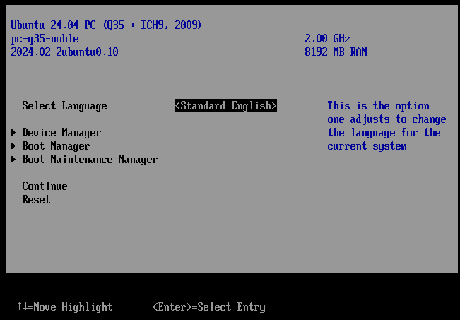

Bootマネージャーを選択します。

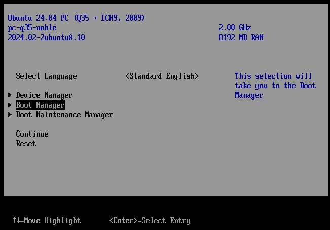

Windows Server ISOファイルがマウントされた DVD-ROMを選択します。
画面の指示にしたがって、CD/DVD-ROMから起動します。

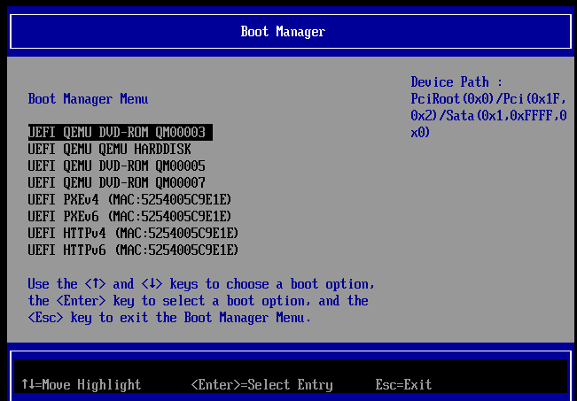

Windows Serverのインストールが始まります。

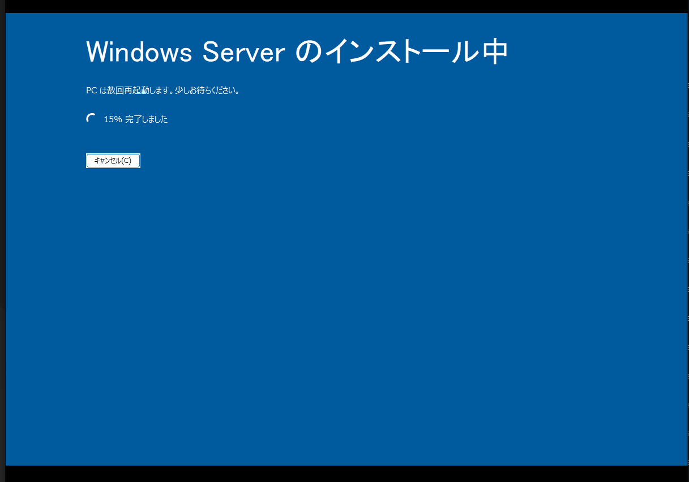

この後、自動でシャットダウンのするので、仮想サーバーを再び起動します。

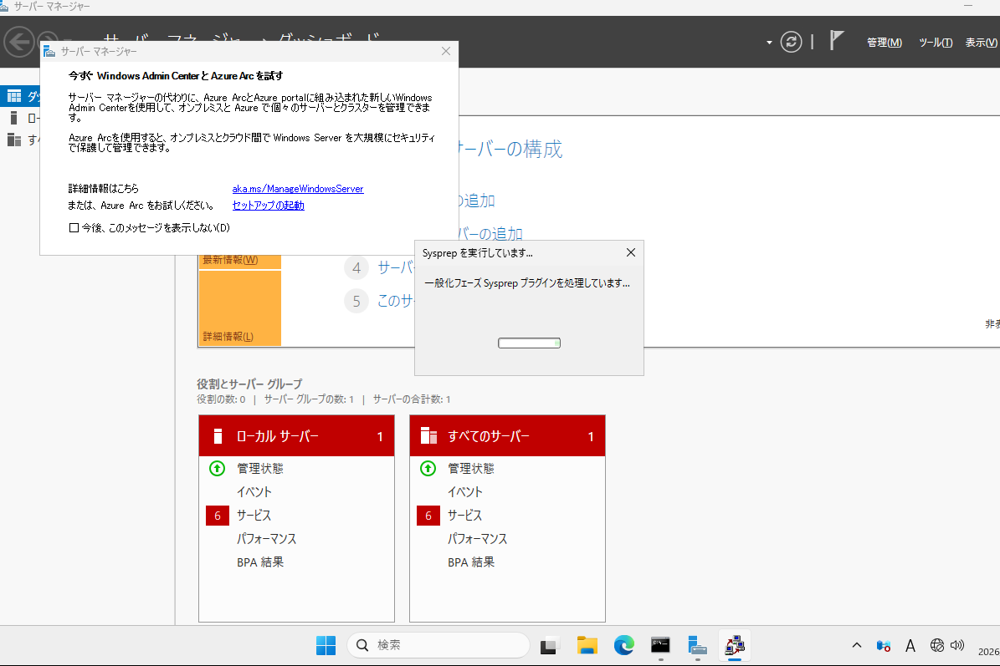

再起動後に、ドライバーなどのインストールが実行され、さらに再起動後に、汎化のため `sysprep` が実行され、シャットダウンします。

これで、Windows Server の クラウドイメージの作成は完了です。


## イメージテンプレートの登録

次のYAMLは、仮想マシンを起動するためのクラウドイメージを Marmotに登録するためのマニフェストです。

```yaml
apiVersion: v1
kind: Image
metadata:
    name: win2k25
spec:
    sourceUrl: file:/var/lib/marmot/windows2025-build.qcow2
    osName: windows
    osVersion: "2025"
```

このYAMLを登録して、イメージをmarmotに登録します。

```bash
mactl create -f win2k25-image.yaml
```

登録作業が完了すると、`STATUS` が `AVAILABLE`になります。

```bash
$ mactl get image win2k25
NAME            STATUS     SYNCED    LV     QCOW2  AGE
----            ------     ------    ------  -----  ---
win2k25         AVAILABLE  N/A       no      yes    4m
```

## Windows Server 2025 仮想サーバーの起動

次はWindows Server 2025の仮想サーバーをデプロイするためのマニフェストです。
イメージテンプレートのボリュームは 40GBだったのに対して、次のマニフェストでは、プロビジョニング時に、64GBに拡大します。

```yaml
apiVersion: v1
kind: Server
metadata:
    name: win2k25-vm
spec:
    cpu: 4
    memory: 4096
    osVariant: win2k25
    bootVolume:
        spec:
            size: 64
    networkInterface:
        - networkname: "host-bridge"
```

VMを起動した時の例です。

```bash
$ mactl create -f win2k25-vm.yaml 
リソースの作成要求が受け入れられました。ID: 5a3fd

$ mactl get server win2k25-vm
NAME             NODE          STATUS        CPU  RAM(MB)  IP-ADDRESS       NETWORK          AGE
----             ----          ------        ---  -------  ----------       -------          ---
win2k25-vm       hv0           PROVISIONING  4    4096     192.168.1.187    host-bridge      9s
```

しばらく時間が経過すると、`STATUS`が `RUNNING`となります。初回起動時は、この段階でリモートデスクトップで接続はできません。

```bash
ubuntu@hv0:~$ mactl get server win2k25-vm
NAME             NODE          STATUS        CPU  RAM(MB)  IP-ADDRESS       NETWORK          AGE
----             ----          ------        ---  -------  ----------       -------          ---
win2k25-vm       hv0           RUNNING       4    4096     192.168.1.187    host-bridge      6m

```

## 初回起動時のログインとパスワード設定

初回起動時は、`mactl console --graphical win2k25-vm` コマンドで、SPICEを使ってグラフィックコンソールに接続します。オプション `--graphical` は、省略形 `-g` を使うことができます。


```bash
ubuntu@hv0:~$ mactl console --graphical win2k25-vm
host: 192.168.1.8
port: 5906
passwd: 5cc73a3e1646994d781ea5a0de681464

remote-viewer spice://192.168.1.8:5906
```

SPICEクライアントでログインします。

```bash
remote-viewer spice://192.168.1.8:5906
```

passwdの入力を求めてくるので、上記のパスワードをインプットします。

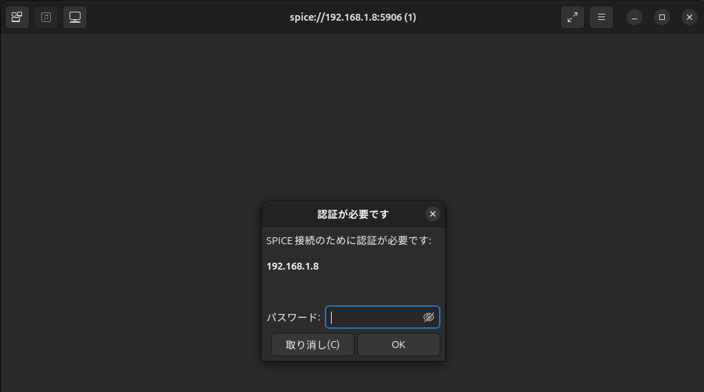

初回起動時のみ、地域、言語、ライセンス条項の承諾などを進めます。

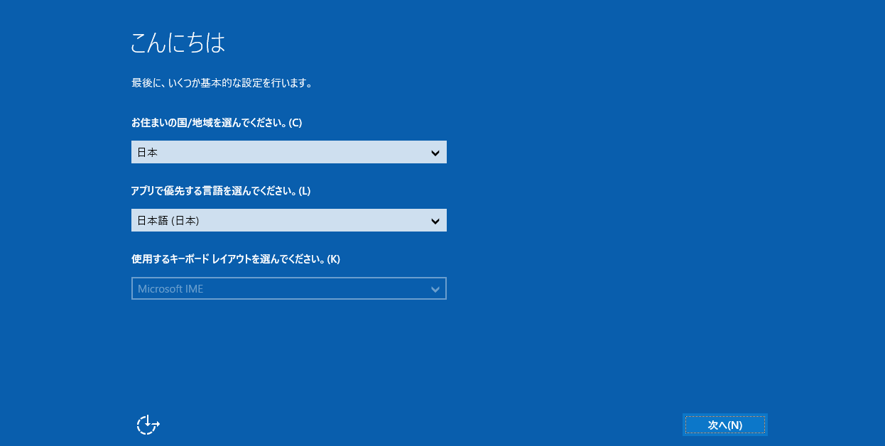

administratorのパスワードを設定します。次からログインするためのパスワードです。忘れないように記憶してください。

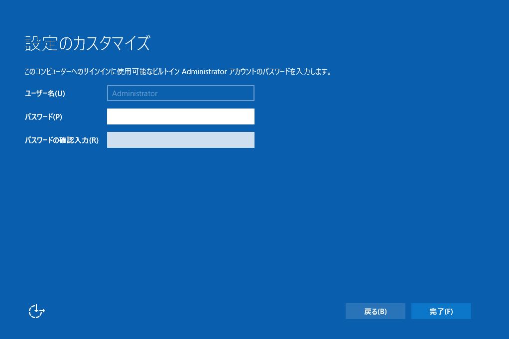

「診断データをMicrosoftに送信する」画面で選択で、好みに合わせて選択します。

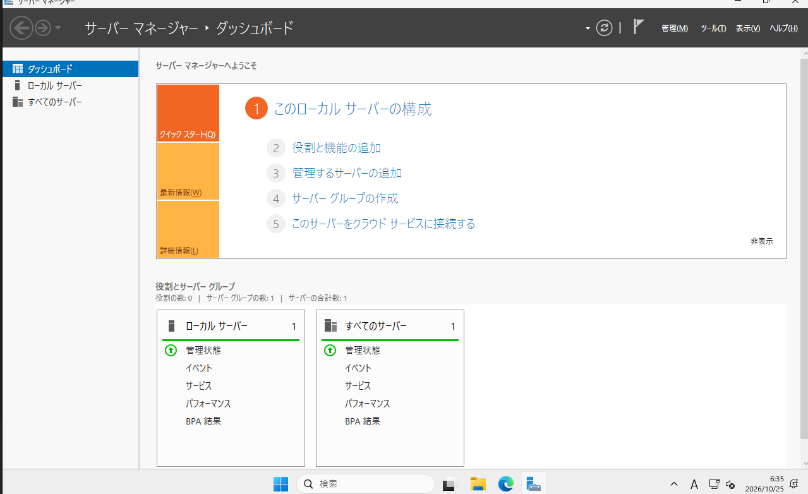


この後、DHCPクライアントとして取得されたIPアドレスは、marmotが割当たIPアドレスに再設定され、`host-bridge`で接続できるようになります。

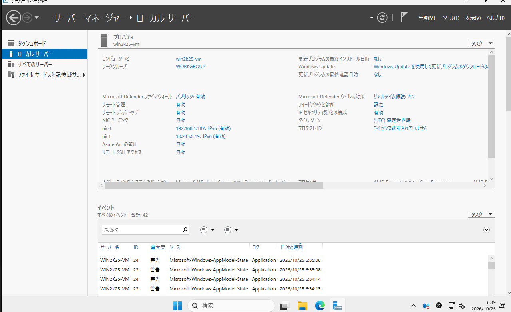


## リモートデスクトップで接続

マイクロソフト リモートデスクトップで、ユーザー administrator で、前述で設定したパスワードで接続することができます。

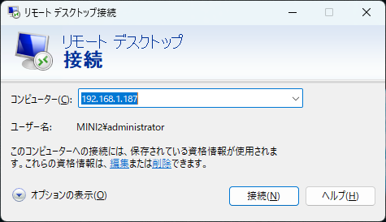


リモートデスクトップで接続した例です。適切に設定されていれば、DNSでアドレスが解決されブラウザを利用できるようになります。


