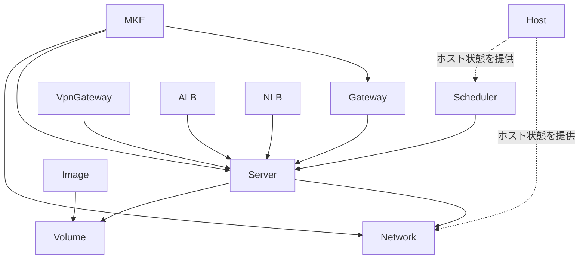

# Marmot コントローラー一覧

Marmot のコントローラーは、etcd 上のリソース定義（desired state）を定期的にポーリングし、実体（libvirt / LVM / OVS / OVN / VM 内ミドルウェアなど）を望ましい状態へ収束させる reconcile ループである。
各ノードの `marmotd` が同じコントローラー群を起動し、ノード割り当て（`metadata.nodeName`）で担当を分担する。

## 1. 全体像

### 1.1 共通の仕組み

| 項目 | 内容 |
|---|---|
| 起動箇所 | [cmd/marmotd/marmotd-main.go](../cmd/marmotd/marmotd-main.go) が API サーバーの起動前後に順次 `Start*Controller` を呼ぶ。1つでも起動に失敗すると `marmotd` は終了する |
| 実装場所 | [pkg/controller/](../pkg/controller)（内部 DNS のみ [pkg/internal-dns/](../pkg/internal-dns)） |
| 制御方式 | `time.Ticker` による定期ポーリング（etcd watch は未使用）。`Stop()` で停止できる |
| 状態管理 | 各リソースの `status.statusCode` を状態機械として遷移させる。状態定義は [pkg/db/](../pkg/db) |
| 削除方式 | API は `status.deletionTimeStamp` を付与するだけで、コントローラーが猶予時間（`deletion_delay_seconds`、既定 10 秒。Gateway 系 / ALB / NLB / MKE は 15 秒固定）経過後に `DELETING` へ遷移させて実体を削除する |
| ノード分担 | [node-filter.go](../pkg/controller/node-filter.go) の `evaluateNodeAssignment` で、`metadata.nodeName` が自ノードのリソースのみ処理する。未割当のリソースは処理しない |
| リーダー選出 | Scheduler / Network コントローラーの一部処理は `IsSchedulerLeader`（アクティブホストのうち HostId が最小のノード）でのみ実行する。アクティブ判定は最終更新から 30 秒以内（`ActiveHostThreshold`） |

### 1.2 一覧

| # | コントローラー | 対象リソース | 周期 | 実装ファイル |
|---|---|---|---|---|
| 1 | VM（Server） | Server | 5 秒 | `server-controller.go` |
| 2 | Volume | Volume | 5 秒 | `volume-controller.go` |
| 3 | Network | VirtualNetwork | 5 秒 | `network-controller.go` |
| 4 | Gateway | Gateway | 15 秒 | `gateway-controller.go` |
| 5 | VPN Gateway | VpnGateway | 15 秒 | `vpn-gateway-controller.go` |
| 6 | Application Load Balancer | ApplicationLoadBalancer | 15 秒（`MARMOT_LB_CONTROLLER_INTERVAL_SECONDS` で変更可） | `application-load-balancer-controller.go` |
| 7 | Network Load Balancer | NetworkLoadBalancer | 15 秒 | `network-load-balancer-controller.go` |
| 8 | Kubernetes Engine（MKE） | KubernetesEngine | 10 秒 | `kubernetes-engine-controller.go` ほか |
| 9 | 内部 DNS サーバー | 内部 DNS エントリー | イベント駆動（DNS 要求） | `pkg/internal-dns/dns-server.go` |
| 10 | Image | Image | 5 秒 | `image-controller.go` |
| 11 | Host | HostStatus（自ノード） | 10 秒 | `host-controller.go` |
| 12 | Scheduler | Server（未割当 PENDING） | 5 秒 | `scheduler-controller.go` |

`marmotd` の起動順は 1 → 2 → 3 → 4 → 5 → 6 → 7 → 8 → 9 → (OS イメージ登録) → 10 → 11 → 12。

### 1.3 リソース間の依存関係

Gateway / VPN Gateway / ALB / NLB / MKE は、内部で専用の Server（VM）を作成し、その VM 上へ Ansible 等で設定を投入する。VM の作成自体は VM コントローラーが担当する。

---

## 2. コアコントローラー

### 2.1 VM（Server）コントローラー

- 開始: `StartVmController`、周期 5 秒
- 役割: Server リソースのライフサイクル（作成・起動・停止・削除）を libvirt 上の VM に反映する。

| 状態 | 処理 |
|---|---|
| `PENDING` | ストレージ配置からノードを解決・割当し、`PROVISIONING` → VM 作成 → `RUNNING`。依存関係の準備待ちなどリトライ可能なエラーは `PENDING` に留める |
| `RUNNING` | CPU / メモリ設定の変更を VM へ反映 |
| `STOPPING` / `STARTING` | VM の停止 / 起動を実行 |
| `DELETING` | VM 実体削除、IP アドレス解放、OVN 論理ポート削除、内部 DNS エントリー削除、ブート / 非永続ボリュームの削除予約、etcd からの削除 |
| `PROVISIONING`（ループ検出時） | 再起動等で中断された作成とみなし `ERROR` に遷移（自動再開しない） |
| `ERROR` / `STOPPED` | 監視のみ |

補足:

- クラスタ内にノードが存在しない場合は VM 実体の削除をスキップし、定義の削除を継続する。
- 削除中のサーバーは、割当ノードが存在しなくても削除を継続できる（ノード判定のバイパス）。

### 2.2 Volume コントローラー

- 開始: `StartVolController`、周期 5 秒
- 役割: LVM / QCOW2 ボリュームの作成・削除と実体の存在確認。

| 状態 | 処理 |
|---|---|
| `PENDING` | `PROVISIONING` → ボリューム作成。iSCSI 公開指定の LVM データボリュームは iSCSI ターゲットも構成 → `AVAILABLE` |
| `AVAILABLE` | 実体（バッキングストア）の存在を確認し、欠損していれば `UNAVAILABLE` |
| `DELETING` | iSCSI 公開解除 → 実体削除 → etcd から削除 |
| `ERROR` / `UNAVAILABLE` / `PROVISIONING` | 監視のみ |

補足:

- 存在しない `nodeName` が指定されたボリュームは `ERROR` にするか、定義を削除する。
- 最終更新から 10 分（`VOLUME_STALE_TIMEOUT`）以上 `ERROR` / `PROVISIONING` のままのボリュームは削除キューに登録する。

### 2.3 Network コントローラー

- 開始: `StartNetController`、周期 5 秒
- 役割: 仮想ネットワーク（libvirt ネットワーク + OVS / OVN ファブリック）の作成・削除・整合性維持。

ループごとの共通処理:

1. 既存の libvirt 仮想ネットワークを DB へ取り込む（`CheckVirtualNetworks`）。
2. 管理ネットワーク `mgmt` が存在することを保証する（`EnsureManagementNetwork`）。
3. リーダーノードのみ、クラスタメンバー変化時の Geneve オーバーレイ構成の再調整と、head ノードが消えた `mgmt` の引き継ぎを行う。

複数ノードにまたがるネットワークは、**head**（正）と **follower**（各ノードの複製）で構成される。

| 状態 | 処理 |
|---|---|
| `PENDING` | head: follower エントリーを `WAITING` で作成し、ネットワークを構築。follower: `WAITING` へ |
| `PROVISIONING` | head / follower それぞれ構築を継続 |
| `WAITING` | follower が head の完了を待ち、完了後に同期 |
| `ACTIVE` | head: Geneve オーバーレイメッシュを維持。follower: head との整合を維持 |
| `ERROR` | 自動復旧を試行。削除要求がある head は follower へ削除意図を伝播 |
| `DEL-PENDING` | 依存リソース（サーバー NIC 等）が残っているため削除を待機 |
| `DELETING` | libvirt の destroy / undefine → ブリッジ削除 → etcd から削除 |

### 2.4 Image コントローラー

- 開始: `StartImageController`、周期 5 秒
- 役割: OS イメージの取り込み・作成・クラスタ内配布・削除。

| 状態 | 処理 |
|---|---|
| `PENDING` | follower エントリーを `WAITING` で作成。取り込み済み QCOW2 は `AVAILABLE` へ。それ以外は `CREATING` にして、URL からのダウンロード、または稼働中 VM のブートボリュームからのイメージ作成を goroutine で実行（タイムアウトあり） |
| `WAITING` | head の完了後、follower が head から同期 |
| `AVAILABLE` | 実体を確認（欠損なら `DELETED`）。follower の spec を head と同期 |
| `DELETING` | イメージ実体を削除 |
| `CREATION_FAILED` / `CREATING` | 監視のみ |

### 2.5 Host コントローラー

- 開始: `StartHostController`、周期 10 秒
- 役割: 自ノードの状態（CPU / メモリ / ストレージ等）を収集して etcd の HostStatus を更新する。これがノード生存判定（アクティブホスト）の根拠になる。あわせて OVN ランタイムの bootstrap を再試行する（`EnsureOVNRuntimeBootstrap`）。

### 2.6 Scheduler コントローラー

- 開始: `StartSchedulerController`、周期 5 秒
- 役割: 未割当の `PENDING` Server に実行ノードを割り当てる。
- 動作: リーダーノードのみが実行する。アクティブかつスケジュール可能（`unschedulable` でない）なノードのうち、割当済みサーバー数が最少のノードを選ぶ。`metadata.nodeName` が指定済みの場合は割当を変更せず、クラスタに存在しないノード名であれば `ERROR` にする。

---

## 3. ネットワークサービス系コントローラー

Gateway / VPN Gateway / ALB / NLB は同じパターンで動作する。

1. `PENDING`: 内部ネットワークを検証し、専用 Server（VM）エントリーを作成して `PROVISIONING` へ。
2. `PROVISIONING`: VM が `RUNNING` になれば `CONFIGURING`、`ERROR` なら `FAILED`。
3. `CONFIGURING`: SSH 到達性を待ち（未到達の間はリトライ回数を消費しない。上限 5 分）、Ansible Playbook を生成・実行して `ACTIVE`。失敗時はリトライ上限まで再試行し、超過で `FAILED`。
4. `ACTIVE`: 専用 VM の消失・エラーを監視し、設定ハッシュの差分（drift）を検出したら `CONFIGURING` へ戻す。
5. `DELETING`: 専用 Server に削除タイムスタンプを設定し、VM が消えたらリソース定義を削除。

専用 VM が外部から削除された場合は、リソース定義も自動削除する。Playbook テンプレートは [pkg/controller/gateway-playbooks/](../pkg/controller/gateway-playbooks) にある。

### 3.1 Gateway コントローラー

- 開始: `StartGatewayController`、周期 15 秒
- 役割: インターネットゲートウェイ。内部ネットワークの VM を外部へ接続する。
- 設定内容（`gateway-iptables.yaml.tmpl`）: IPv4 forwarding、専用 iptables チェーン（INPUT / FORWARD / nat PREROUTING）、`serverPorts` に対する DNAT、masquerade、`remoteCIDR` 以外の拒否、再起動後の復元用 systemd ユニット。
- 接続先: SSH / Ansible は `spec.bindPublicIpAddress` へ接続し、DNAT 先は `spec.internalServerName` と `spec.internalVirtualNetwork` から解決した内部サーバー IP。
- Ansible リトライ上限: 3 回

### 3.2 VPN Gateway コントローラー

- 開始: `StartVpnGatewayController`、周期 15 秒
- 役割: OpenVPN による VPN ゲートウェイの構築（`vpn-gateway-openvpn.yaml.tmpl`）。内部ネットワークの CIDR を VPN クライアントへ公開する。
- 状態遷移: 上記共通パターン。Ansible リトライ上限は 5 回。

### 3.3 Application Load Balancer コントローラー

- 開始: `StartApplicationLoadBalancerController`、周期 15 秒（`MARMOT_LB_CONTROLLER_INTERVAL_SECONDS` で変更可）
- 役割: HAProxy による L7 ロードバランサー。リスナーごとのバックエンドを解決し、HAProxy 設定を生成する。
- 設定投入方式（`load-balancer-haproxy.yaml.tmpl`）: Ansible で HAProxy と `marmot-lb-agent` をインストールし、desired config（`haproxy-desired.cfg`）を配置する。HAProxy 本体への適用は VM 内の `marmot-lb-agent`（[5.3](#53-marmot-lb-agent)）が行い、コントローラーは agent の適用結果（state.json）を観測して `ACTIVE` / `DEGRADED` を判定する。
- 追加状態: `DEGRADED`（バックエンドが利用不可、または agent の状態読み取りが連続失敗）。バックエンドが復旧すれば `ACTIVE` に戻る。
- 設定ハッシュ: 配置済みハッシュ（staged）と適用済みハッシュ（applied）を区別し、差分があれば `CONFIGURING` に戻す。

### 3.4 Network Load Balancer コントローラー

- 開始: `StartNetworkLoadBalancerController`、周期 15 秒
- 役割: iptables（DNAT）による L4 ロードバランサー（`network-load-balancer-iptables.yaml.tmpl`）。専用チェーン（INPUT / FORWARD / PREROUTING / POSTROUTING）と再起動後の復元用 systemd ユニットを構成する。
- 追加状態: `DEGRADED`（バックエンド不在）。
- リトライ: 環境変数 `MARMOT_NLB_APPLY_RETRY_MAX`（既定 3 回）、`MARMOT_NLB_APPLY_RETRY_BACKOFF_SECONDS`（既定 10 秒）で調整できる。

---

## 4. Kubernetes Engine（MKE）コントローラー

- 開始: `StartKubernetesEngineController`、周期 10 秒
- 設定: `/etc/marmot/mke.json`（`marmotd.DefaultMKEConfigPath`）。読み込めない場合は起動に失敗する。
- 役割: Marmot Kubernetes Engine のクラスタ全体（専用ネットワーク、コントロールプレーン、ノード VM、ロードバランサー、アドオン）のライフサイクル管理。
- 実装: `pkg/controller/kubernetes-engine-*.go` に機能別に分割されている。
- コントロールプレーンはホストローカル（netns + systemd）の実体なので、`metadata.nodeName` の担当ホストのみが構築・復旧・解体する（スプリットブレイン防止）。エンジンごとの etcd ロック（`/lock/kubernetes-engine/reconcile/<id>`）で状態遷移を直列化する。

### 4.1 状態遷移

| 状態 | 処理 |
|---|---|
| `PENDING` | クラスタ専用ネットワーク（`mke-<クラスタ名>`）を作成し `PROVISIONING` へ |
| `PROVISIONING` | コントロールプレーン構築 → ロードバランサー VM 構築 → ノード VM 構築。全てが Ready になれば `RUNNING`。途中の失敗は状態を維持したままメッセージに記録し、次周期で冪等に再試行 |
| `RUNNING` | `spec.nodes` と実ノード数を比較して `SCALING_OUT` / `SCALING_IN`、`spec.version` の差で `UPGRADING` へ遷移。netns 消失時のコントロールプレーン復旧、Pod CIDR 宛の静的経路の再設定を毎周期実施 |
| `SCALING_OUT` | 不足ノードを作成・セットアップし、全ノード Ready で `RUNNING` へ |
| `SCALING_IN` | 超過ノードのうち index 最大の 1 台を cordon → drain → ノード削除 → VM 削除要求（1 周期 1 台） |
| `UPGRADING` | コントロールプレーンを先に更新し、その後ノードを index 昇順に 1 台ずつ cordon → drain → バイナリ差し替え → uncordon → Ready 確認。自動ロールバックはしない |
| `DELETING` | LB VIP の解放、Ceph RBD イメージ削除、ノード VM 削除要求、コントロールプレーン解体（systemd ユニット / etcd / netns / IP 解放）、専用ネットワーク削除を行い、完了確認後に etcd から削除 |
| `FAILED` | 監視のみ |

### 4.2 機能別ファイル

| 機能 | ファイル |
|---|---|
| コントロールプレーン構築・解体・更新 | `kubernetes-engine-control-plane*.go`（assets / binary / network / NAT / systemd / upgrade） |
| 専用 etcd | `kubernetes-engine-etcd*.go` |
| PKI（CA・証明書・admin kubeconfig） | `kubernetes-engine-pki.go`, `kubernetes-engine-admin-kubeconfig.go` |
| ノード VM 作成・SSH 設定・経路 | `kubernetes-engine-node.go`, `kubernetes-engine-node-ssh.go` |
| スケールイン / ノードアップグレード | `kubernetes-engine-node-scale-in.go`, `kubernetes-engine-node-upgrade.go` |
| ロードバランサー VM・VIP 管理 | `kubernetes-engine-loadbalancer*.go` |
| CNI（Cilium） | `kubernetes-engine-cni-cilium.go` |
| CSI（Ceph） / Ceph 削除処理 | `kubernetes-engine-csi-ceph.go`, `kubernetes-engine-ceph-cleanup.go` |
| クラスタ DNS / metrics-server | `kubernetes-engine-cluster-dns.go`, `kubernetes-engine-metrics-server.go` |
| Cloud Controller Manager 配備 | `kubernetes-engine-cloudprovider-*.go` |

---

## 5. 補助コントローラー（marmotd 外で動作）

`marmotd` に組み込まれたコントローラーとは別に、クラスタ側の VM 内で動作する独立バイナリがある。いずれも [cmd/](../cmd) 配下。

### 5.1 mke-node-controller

- 実装: [cmd/mke-node-controller/](../cmd/mke-node-controller)
- 動作場所: MKE クラスタ（Cloud Controller Manager として配備される）
- 役割: kube-apiserver と連携し、marmotd の Server API から Node の `ProviderID` / `Addresses` を設定して `node.cloudprovider.kubernetes.io/uninitialized` taint を解消する。`Service type=LoadBalancer` の VIP の払い出し・解放も行う。
- 周期: `--interval-seconds`（既定 5 秒）

### 5.2 mke-lb-controller

- 実装: [cmd/mke-lb-controller/](../cmd/mke-lb-controller)
- 動作場所: MKE 専用ロードバランサー VM
- 役割: kube-apiserver から `LoadBalancer` 種別の Service と Node を収集し、VIP が払い出された Service について HAProxy 設定を生成・検証・reload する。VIP をネットワークインターフェースへ割り当てる。
- 周期: `--interval-seconds`（既定 5 秒）

### 5.3 marmot-lb-agent

- 実装: [cmd/marmot-lb-agent/](../cmd/marmot-lb-agent)
- 動作場所: Application Load Balancer VM
- 役割: desired config（`/etc/haproxy/haproxy-desired.cfg`）を検証して active config へ適用し、HAProxy を reload する。適用結果（ハッシュ・時刻・エラー）を `state.json` に記録し、ALB コントローラーがこれを観測する。多重起動はロックファイルで防ぐ。
- 周期: `--interval-seconds`（既定 5 秒）

---

## 6. 内部 DNS サーバー

- 開始: `internaldns.StartInternalDNSServer`（[pkg/internal-dns/dns-server.go](../pkg/internal-dns/dns-server.go)）
- 他のコントローラーと異なり、ポーリングではなく DNS 要求（UDP）への応答で動作する。
- 役割: etcd 上の内部 DNS エントリー（Server 作成時に登録され、削除時に VM コントローラーが除去する）を名前解決する。`domain` 配下以外の問い合わせは `dns_upstream` へ転送する。転送を許可するクライアントは許可 CIDR で制限され、ワイルドカード待受時は mgmt ネットワークの CIDR を許可リストに加える。
- 設定: `/etc/marmot/marmotd.json`（`dns_listen_addr`、`dns_upstream`、`dns_client_allow_cidrs`、`domain`）

---

## 7. 運用メモ

- ログは `slog` の Debug レベルで「制御ループ実行」が毎周期出力される。状態遷移の追跡は各コントローラーの Debug ログと、リソースの `status.message` を参照する。
- 削除猶予時間は `/etc/marmot/marmotd.json` の `deletion_delay_seconds`（VM / Volume / Network / Image）で変更できる。
- Gateway 系の Ansible Playbook は `/var/lib/marmot/ansible-playbooks` に生成される。
